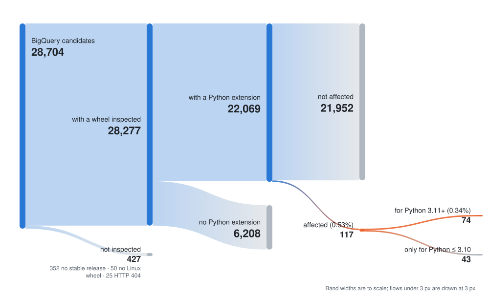

# Appendix: method

Part of the [libpython link survey](README.md).

## Popularity sample

The [15,000 most-downloaded PyPI projects](https://hugovk.dev/top-pypi-packages/)
of October 2026, from Hugo van Kemenade's November 1 list. Its
[ranking query](https://github.com/hugovk/top-pypi-packages/blob/main/clickhouse.py)
sums the previous calendar month's PyPI downloads per project and sorts by
that count, breaking ties by name. The survey's saved project list matches
those 15,000 names, in order. Downloads only chose the sample: each project
counts once.

For each project, the crawler picked a Linux wheel on each of PyPI and
piwheels: from the newest stable release with a non-yanked Linux wheel,
going back to older releases when the newest had none, then chosen as
described in [Choosing the wheel](#choosing-the-wheel). It verified 3,587
wheels, of which 2,942 contained a Python extension, from 1,842 projects.
Six of the eight affected projects were found on PyPI and two on piwheels.

## Latest-release sample

The second sample looks beyond popular projects and describes what projects
ship in their *latest* release. It joins the
[deps.dev package versions](https://docs.deps.dev/bigquery/v1/) to
[PyPI's distribution metadata](https://docs.pypi.org/api/bigquery/), picking
each project's version first and only then looking for that version's Linux
wheels. The reverse order would also find old Linux wheels from projects
that have since become pure Python.

```sql
-- GoogleSQL
WITH latest_stable AS (
  SELECT
    REGEXP_REPLACE(LOWER(Name), r'[-_.]+', '-') AS project,
    Version AS version
  FROM `bigquery-public-data.deps_dev_v1.PackageVersionsLatest`
  WHERE System = 'PYPI'
    AND VersionInfo.IsRelease
  QUALIFY ROW_NUMBER() OVER (
    PARTITION BY project
    ORDER BY VersionInfo.Ordinal DESC, Version DESC
  ) = 1
),
linux_wheels AS (
  SELECT
    REGEXP_REPLACE(LOWER(name), r'[-_.]+', '-') AS project,
    version,
    filename
  FROM `bigquery-public-data.pypi.distribution_metadata`
  WHERE packagetype = 'bdist_wheel'
    AND REGEXP_CONTAINS(
      LOWER(filename),
      r'-(?:[a-z0-9_]+\.)*(?:manylinux[0-9_]|musllinux_|linux_)[a-z0-9_]*(?:\.[a-z0-9_]+)*\.whl$'
    )
)
SELECT
  project,
  version,
  COUNT(DISTINCT filename) AS linux_wheel_count,
  MIN(filename) AS example_wheel
FROM latest_stable
JOIN linux_wheels USING (project, version)
GROUP BY project, version
ORDER BY project;
```

The query returned 28,704 projects. It is only a candidate list: a Linux
wheel can hold an executable or a plain shared library and no Python
extension, and 440 of the returned versions were development releases
despite the `IsRelease` filter. So the crawler used only each row's project
name. It asked PyPI's JSON API for the project's highest non-yanked stable
release at scan time (November 21–24, 2026, UTC) and inspected Linux
wheels from that release, as described next. It never fell back to an
older release. `example_wheel` served only to spot-check the query.

## Choosing the wheel

Each project is judged by one Linux wheel of the release: the one for the
newest Python, the build a user on a current Python installs. Among wheels
for the same Python, manylinux x86-64 comes first, then other x86-64 Linux
wheels, then other architectures, then the first file name.

The crawler first inspects one wheel per release, chosen by platform and
then file name, which often is an older Python's wheel. Only where that
wheel is affected does it also inspect the newest-Python wheel (96 wheels
across both samples), and the project's result is that wheel's. In 33
releases of the latest-release sample the newest-Python wheel was clean, so
those projects are not counted. A project whose first wheel is clean but
whose newest-Python wheel is affected would be missed, so the counts are
lower bounds. The popularity sample's PyPI rows follow the same rule; its
piwheels rows are the first wheel chosen.

## Where the candidates went

<picture>
  <source media="(prefers-color-scheme: dark)" srcset="candidates-funnel-dark.svg">
  
</picture>

| | Projects |
| --- | ---: |
| BigQuery candidates | 28,704 |
| No non-yanked stable release on PyPI | 352 |
| No Linux wheel in that release | 50 |
| HTTP 404 from PyPI | 25 |
| Wheel inspected | 28,277 |
| No Python extension recognized (3,033 with no ELF inspected at all) | 6,208 |
| **With a Python extension: the denominator** | **22,069** |

Of the 28,277 wheels, 26,414 were downloaded and hash-verified, and 1,863
were exact matches (same PyPI project, file name and SHA-256) reused from
the popularity sample; the 94 newest-Python wheels inspected afterwards
are not in that count. 18 files in eight projects could not be inspected (16
without a dynamic symbol table, one truncated ELF, one decompression error);
the rest of those wheels counted.

## What counts as an extension

A file in the wheel counts as a Python extension if it is a shared ELF
object (`ET_DYN`, file name ending in `.so`) whose dynamic symbol table
defines and exports `PyInit_<name>` or `PyModExport_<name>` for the module
name its file name implies (including package `__init__` extensions and the
punycode `PyInitU_` form for non-ASCII names). Each such file counts once,
including several builds of the same module in one wheel.

An extension is *affected* if one of its own `DT_NEEDED` entries names a
libpython: the case where loading it into a statically linked interpreter
fails or loads a second copy of the runtime. Dependencies of its
dependencies, and libraries opened at run time (`dlopen`, `ctypes.PyDLL`),
are out of scope. This is the same check `libpython-linkcheck` performs.

Other ELF files linking libpython are excluded from the headline numbers,
because a program or helper library that embeds Python has every reason to
link it. In the latest-release sample, 607 of the 64,672 other ELF files
inspected did; in 55 of the 77 projects shipping them, no Python extension
had a direct link.

Nothing was executed: the crawler only read wheel contents.
